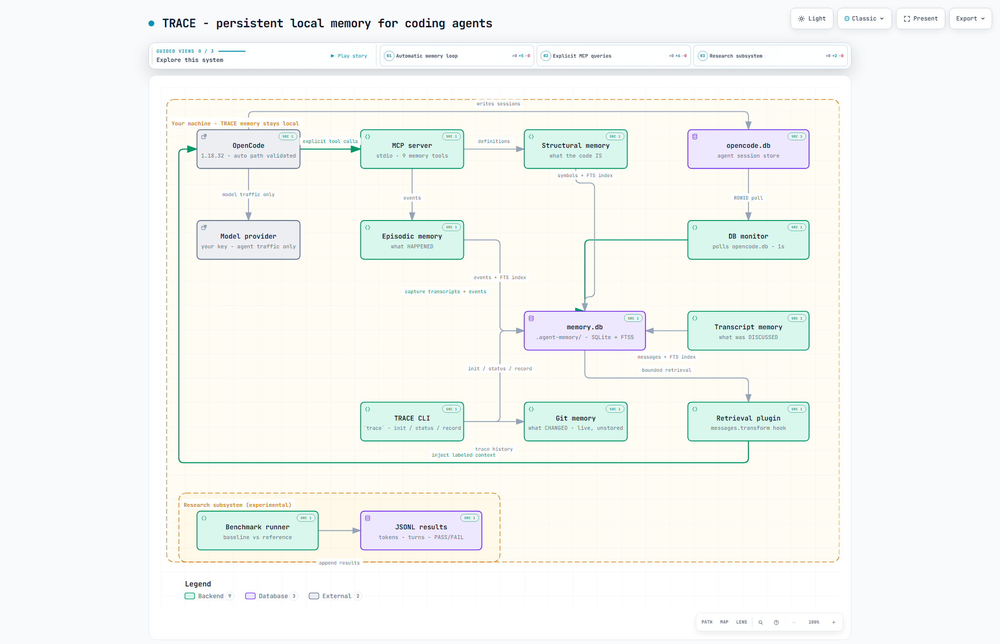

# TRACE

**TRACE gives coding agents persistent local memory across sessions and provides tools to measure its effect.**

TRACE 0.1.x is an experimental research preview.

```powershell
git clone https://github.com/PruvCode/Trace.git TRACE
cd TRACE
python -m pip install -c constraints.txt .
trace install --all --project "PATH_TO_YOUR_PROJECT"
```

## Why TRACE?

Coding agents forget everything between sessions. Every new session
re-discovers the same definitions, re-investigates the same bugs, and
re-makes the same decisions.

TRACE records four kinds of memory locally — what the code **is**, what
**happened**, what **changed**, and what **was discussed** — and exposes them to agents through MCP.
Its strongest differentiator: **TRACE doesn't ask you to believe that
memory works. It gives you the infrastructure to measure it.**

## How it works

| Memory | Question it answers | Source |
|---|---|---|
| Structural | What IS this codebase? (definitions, callers, symbols) | tree-sitter index of your code |
| Episodic | What HAPPENED? (investigations, attempts, decisions) | recorded by agents / you, per session |
| Git | What CHANGED? (commits, files, touched symbols) | deterministic facts from local git history |
| Transcript | What was DISCUSSED? (conversations, sessions) | recorded by agents / you, per session |

```
your project                    agent (any MCP-compatible client)
     │                                    │
     ▼                                    ▼
.agent-memory/memory.db  ◄── stdio ── MCP server
(SQLite + FTS5, local)        find_definition / find_callers /
                              search_symbols / record_event /
                              search_events / get_git_history /
                              record_transcript_message /
                              search_transcripts / get_transcript_session /
                              get_task_context / get_evidence
```

Session N records findings → Session N+1 retrieves them. See
[`examples/auth-debug`](examples/auth-debug) for a 5-minute walkthrough.

## Architecture



- **Agent layer** — Codex, Claude Code, Antigravity, OpenCode, and local stdio MCP clients.
- **TRACE memory layer** — structural, episodic, Git, and transcript services over one interface.
- **Local storage** — one SQLite + FTS5 database per project (`.agent-memory/memory.db`). Agents can send retrieved records to their configured provider.
- **Automatic OpenCode path** — a monitor captures sessions into memory; a plugin injects bounded prior-session context into every model request.
- **MCP explicit-query path** — project memory and evidence tools over stdio.
- **Benchmark/research subsystem** — isolated baseline-vs-memory runs with mechanical evaluation ([interactive diagram](docs/architecture/trace-architecture.html), [memory flow](docs/architecture/trace-memory-flow.html), [benchmark flow](docs/architecture/trace-benchmark-flow.html)).

## Installation

From an existing TRACE installation, run `trace install --all` inside the project you want to enable.
Use `trace doctor` to inspect the result. Start a new agent session and review
the generated hooks and MCP entry in the host when prompted. Each enabled host
uses the same project database.

For setup from a reviewed wheel, supported host behavior, privacy controls,
update and rollback, see [TRACE for coding agents](docs/universal-agents.md).

### Windows x64 preview bundle

Extract `TRACE-Windows-x64.zip` and run one command from the extracted folder:

```powershell
powershell.exe -NoProfile -ExecutionPolicy Bypass -File .\Install-TRACE.ps1
```

The bundle includes TRACE, its own Python and dependencies, and OpenCode.
The installer fetches a pinned copy of Git for Windows if Git is missing.
Open a new PowerShell window and run `trace --version` or `trace-opencode`.
Enable capture separately inside each project that should use TRACE.

### Install from source or wheel

TRACE requires Python 3.11 or newer. Install from a reviewed source checkout in a dedicated environment.

```powershell
git clone https://github.com/PruvCode/Trace.git TRACE
cd TRACE
python -m venv .venv
.venv\Scripts\Activate.ps1
python -m pip install -c constraints.txt .
```

For development with pytest:

```powershell
python -m pip install -c constraints.txt -e ".[dev]"
```

## OpenCode legacy setup and automatic capture

The recommended workflow uses **transparent automatic capture** — TRACE monitors your coding agent session without any wrapper commands. You just run your agent normally.

### One-time setup

```powershell
# 1. Install TRACE
git clone https://github.com/PruvCode/Trace.git TRACE
cd TRACE
python -m venv .venv
.venv\Scripts\Activate.ps1
python -m pip install -c constraints.txt .

# 2. Open OpenCode once, then initialize TRACE in your project
cd your-project
trace init
trace setup opencode --transparent
```

### Normal coding session

```powershell
# 3. Just run OpenCode normally — TRACE captures automatically
opencode

# ... code normally with OpenCode ...

# 4. Inspect capture status after your session
trace status
```

### Next session — continue where you left off

```powershell
# 5. Just run OpenCode again — TRACE makes previous context available
opencode

# TRACE automatically injects prior-session findings, decisions, and discussion
# as one labeled contextual message; the agent can additionally search
# transcripts, events, and code structure from Session 1 via MCP tools
```

### Manual commands (optional, for developers)

If you want fine-grained control, TRACE also provides manual commands:

```powershell
# what TRACE knows
trace status
trace find get_session_timeout
trace callers refresh_token
trace search "timeout"

# record a finding (agents do this via record_event)
trace record --type investigation --symbol get_session_timeout `
  --message "timeout flows get_session_timeout -> refresh_token"

# retrieve it later (agents do this via search_events)
trace events --symbol get_session_timeout

# record/search transcript memory
trace transcript record --session-id abc123 --role user --content "We found the bug"
trace transcript record --session-id abc123 --role assistant --content "The fix is to reorder middleware"
trace transcript search --query "middleware"
trace transcript show --session-id abc123

# manually retrieve relevant context (normal OpenCode sessions inject automatically)
trace context "authentication timeout"

# monitor transparent capture
trace monitor status
trace monitor stop

# full terminal summary
trace report

# re-index after big changes, delete when done
trace index
trace reset . --yes
```

`trace init` is idempotent — re-running it re-indexes structural memory
while keeping recorded events and transcripts.

### How it works

1. **Setup** (`trace setup opencode --transparent`): adds only a `trace-memory` entry to the
   project's `opencode.json` (refusing, with the exact entry to add by hand, if the file is
   not plain JSON — e.g. it has comments), writes a project-local plugin
   (`.trace-service/opencode-plugin.js`) and lists it in the same file, and starts one
   background capture monitor for the project. OpenCode installs its plugin SDK the first time
   any plugin is configured for a user (about 60 MB and two minutes on first start, once). OpenCode's database is found via `$XDG_DATA_HOME` (default
   `~/.local/share/opencode/opencode.db`). `trace teardown opencode` reverses all of this
   and keeps your memory.

2. **Capture** (Automatic): Run `opencode` normally. The monitor copies rows once OpenCode has
   finished writing them (streaming replies are captured complete, not half-written):
   - User/assistant text → Transcript memory (status rows such as step-finish are not stored)
   - Completed memory-tool calls (prefixed `trace-memory_*` names included) → searchable
     capture activity (`trace events`), never shown as a "finding"
   - Every row has a stable source id, so restarts and replays never duplicate it; a row that
     fails to save is retried, never skipped, and the error is logged in
     `.trace-service/service.log` (no message content) and shown by `trace service status`.
   - After a crash or reboot, the next OpenCode session start catches up and restarts capture.

3. **Retrieval** (Automatic): Run `opencode` again. At the first model request of a session the
   plugin builds a bounded block of prior memory (one Python run per session) and adds it,
   clearly labeled (`[TRACE PROJECT MEMORY - ...]`), to **every** model request of that
   session. Messages matching the session's first prompt are added to the block
   (`TRACE_TASK_AWARE=0` turns this off) — OpenCode does not keep plugin-added messages between requests, so injecting
   once would hide memory from later agent steps. The MCP server remains available for
   explicit queries, and `trace context "query"` retrieves context manually.

### What is captured automatically

| Event Type | Stored As | Queryable Via |
|------------|-----------|---------------|
| User message | Transcript | `trace transcript search`, `trace context` |
| Assistant response (once complete) | Transcript | `trace transcript search`, `trace context` |
| Completed memory-tool call | Event (`source=capture`) | `trace events` |
| Supported pytest outcome, with project opt-in | Event and linked tool evidence | `trace events --query pytest` |

### What is NOT captured automatically

- Raw shell commands and output, file reads/writes, and web fetches
- Step markers and finish reasons ("tool-calls", "stop")
- Sessions from other project directories (each project has its own database)

### Privacy

- All capture happens locally — no network calls by TRACE
- Best-effort redaction before storage and again before injection (Anthropic/OpenAI/GitHub/
  Stripe/AWS/Slack/Google key formats, private keys, JWTs, connection strings, and
  `password=`/`API_KEY=`-style assignments). Pattern matching cannot catch every secret:
  do not treat captured transcripts as safe to share.
- Transcript data stored in same local SQLite DB as other memory layers
- `trace service stop` pauses capture (it stays off until `trace service start`);
  `trace reset . --yes` stops capture and deletes the project's memory

## Agent Integration

TRACE exposes memory over [MCP](https://modelcontextprotocol.io/) (stdio,
local process). Any MCP-compatible agent can use it:

1. Run `trace init` in your project.
2. Run `trace setup opencode --transparent` (or `trace setup opencode` for manual capture).
3. The agent can now call the memory tools via MCP; everything it records
   persists in `<project>/.agent-memory/memory.db` for the next session.

With the OpenCode integration, both directions are automatic: the background monitor captures sessions,
and the project-local plugin adds bounded prior-session memory to every
model request as one labeled contextual message — the agent does not need
to call any retrieval tool for the previous session to be available.
OpenCode setup enables the four memory tools used in prior trials
(`record_event`, `search_events`, `search_transcripts`,
`get_transcript_session`) plus `get_evidence` for expanding references.
`trace mcp` prints the full server configuration for other clients, and `trace`
commands cover the rest.

Supported: any agent that speaks MCP over stdio and can spawn a local
command (e.g. OpenCode with MCP configured) can use explicit MCP querying.
The automatic zero-touch workflow (capture + injection with no manual
commands) has been run on the OpenCode versions in the compatibility matrix.
Other agents do not inherit it unless a corresponding integration exists, and
untested clients should be treated as experimental.

## Memory Storage

- One database per project: `<project>/.agent-memory/memory.db`
  (SQLite + FTS5). Projects never share memory.
- Add `.agent-memory/` to your project's `.gitignore` (`trace init`
  reminds you inside git repositories) so local memory stays local.
- Structural rows are rebuilt deterministically on `trace index`;
  episodic events are append-only until you run `trace reset`.
- All queries are parameterized and result-bounded (default 10, max 50).
- Automatic session-start retrieval policy: the newest 10 user/assistant
  messages — from the most recent prior session first, older sessions only
  fill unused budget, subagent sessions skipped — plus up to 5 recent
  recorded findings, capped at 20 items / 4000 characters (oldest messages
  yield first; long messages keep head and tail), project-scoped,
  deterministically ordered, fail-open, with best-effort secret redaction.
- Recorded findings can carry a lifecycle (stored in the event payload; older
  events stay valid): `status` is `hypothesis`, `observed` or `verified`, and
  `supersedes` names earlier event ids a finding replaces
  (`trace record --status verified --supersedes 12`, or the MCP
  `record_event` tool's `status`/`supersedes` arguments). New sessions are
  shown only current findings, with hypotheses and verified findings
  labeled; superseded ones stay searchable (`superseded_by` in
  `search_events`). A finding linked to a `file` is flagged
  "may be stale" when that file changed or disappeared after it was
  recorded; unrelated changes never flag it. Earlier transcript messages
  carry no lifecycle: they are shown as history, labeled by session.
- Search matches each word literally (so `refresh-token` and `v1.2.3` work),
  ranks best match first with newer entries breaking ties, and reports a
  query with no searchable words as an error rather than "no results".
- Injected synthetic memory is labeled `[TRACE PROJECT MEMORY - ...]` and
  is never re-captured as ordinary transcript memory.
- Inspect with `trace status` / `trace report`, or open the SQLite file
  with any SQLite browser.

## Task library

Give an investigation a stable ID and optionally group it by subsystem. The
commands below use the current project. Use `--project` to select a different
project for `trace task`.

```text
trace task create --title "Login timeout" --subsystem auth
trace task list --subsystem auth
trace record --type attempt --task TASK_ID --message "Increasing the timeout did not fix login"
trace events --task TASK_ID --query timeout
trace task show TASK_ID
```

Use the ID returned by `trace task create`. `trace task link TASK_ID EVENT_ID`
assigns an existing unassigned event to the task. Use `trace events` to find
legacy event IDs. Existing event searches without a task filter still search
the project. OpenCode uses an explicit session binding to select task context.
Bound sessions can also receive up to two matching messages from prior sessions assigned to that task.
Unbound sessions receive general findings and unassigned conversations.

Attach evidence when recording an event:

- `--transcript-evidence MESSAGE_ID` links a message in this project's TRACE
  database. Find its ID with `trace transcript search`.
- `--git-evidence FULL_COMMIT:repo/relative/file.py` links a file at a commit
  already present in the project’s local Git repository. Use the Git root as
  the TRACE project for this option.

Both flags are repeatable, up to ten references total. TRACE stores links
without copying transcript text or Git file contents into the event. A link
identifies a source and does not verify the finding. In MCP, use the optional
`task_id` on `record_event` and `search_events` and pass references in
`record_event.evidence` as objects with `type: "transcript"` and
`message_id`, or `type: "git"`, `commit` and `path`.

## Opt-in pytest outcomes

After setting up automatic OpenCode capture, enable structured test evidence for
this project with `trace test-capture on`. Use `trace test-capture status` to
inspect the setting and `trace test-capture off` to stop collecting new outcomes.
Only tool records created after opt-in are eligible. Turning it off preserves
previous evidence.

TRACE recognizes direct `pytest` and `python -m pytest` calls, including common
short options and simple test paths. Compound shell commands, other runners,
unfinished calls, and tool results with neither a recognizable summary nor an
exit code are skipped. The evidence contains an outcome, available counts,
and OpenCode source IDs. When pytest reports a failure, TRACE can recover up
to four project-local failing test identifiers in the bound task's context.
These identify historical checks to rerun. Raw shell commands, arguments,
assertion values, and error text stay in OpenCode. The outcome reflects the
tool's report.

When a verified decision names functions or methods, TRACE can show their
indexed definitions and the parts of the decision that name them. These links
help an agent check the definition and its callers before editing. TRACE
omits ambiguous names and definitions whose source has changed since indexing.
Run `trace index` after moving or editing code to refresh the locations.
Agents connected to the full TRACE MCP server can request the same task context
on demand using `get_task_context` with the task ID and the current query.
Pass a repository-relative `file` to retrieve only findings recorded for that
file. The CLI equivalent is `trace context "query" --task TASK_ID --file path/to/file`.

Use `trace transcript sessions` to find a captured OpenCode session and
`trace task bind-session TASK_ID SESSION_ID` to assign its future captured
outcomes explicitly. Without a binding the outcomes remain unassigned.
Use `trace events --query pytest` or the task's event history to inspect them.
Re-run `trace setup opencode --transparent` on upgrade to install the updated
plugin that passes the first prompt to the retrieval helper over standard input.
Restart OpenCode to load the plugin. If the TRACE monitor was already running
when you upgraded, run `trace service restart` to load the new capture code.

## Task context and evidence

Use `trace task bind-session TASK_ID SESSION_ID` to give a captured OpenCode
session its task context. Updated plugins refresh their cached context after
the binding changes. The task context prefers current findings and linked
test outcomes. If the task has no usable findings, TRACE searches unassigned
history for matches to the prompt. It excludes findings and conversations
assigned to other tasks.

```text
trace context "login timeout" --task TASK_ID
trace task show TASK_ID
trace evidence EVIDENCE_REF --task TASK_ID
```

Use a reference from the context block or `evidence_refs` in an event search.
The MCP tool `get_evidence` takes the same reference and optional task ID.
Expansion returns a redacted, framed page. Use its `next_offset` with
`--offset` or the MCP `offset` argument to continue. Source bodies over 64 KiB
and non-UTF-8 Git blobs receive a status instead of text.

Git freshness compares the recorded blob with HEAD and the checked-out file.
TRACE marks a changed or missing path stale and leaves freshness unknown when
it cannot establish a comparison. The startup block keeps superseded claims
out and shows up to two references per finding. Explicit expansion still
shows the original evidence with its supersession label. Freshness reflects
the files at context assembly or expansion time.

## Measurement

TRACE measures token usage so you can evaluate whether memory helps your
workflow. Per-run accounting (input/output/total tokens, turns, tool
calls, memory tool calls, latency) is recorded by the benchmark runner,
and summarized descriptively:

```powershell
python -m benchmark.runner --task tasks/A_control/task_01_timeout_fix --config configs/baseline.yaml
python -m benchmark.analyze --results runs/workspaces/<exp_id>/results.jsonl --tasks-root tasks
```

Token counts come from exact provider `usage`, never estimates. TRACE
makes no claim that memory saves tokens — it gives you the numbers to
compare baseline vs. memory runs yourself.

A preregistered two-session comparison (10 synthetic tasks, one free model,
two runs) found that on tasks needing earlier-session knowledge, memory beat
no memory (83% vs 38% pooled), but **TRACE did not beat a plain AGENTS.md
notes file** (83% vs 83%, inconclusive at this sample size) and used about
twice the input tokens. A later held-out test on longer histories, cut short by
a usage limit (30 valid runs on four tasks), found notes and current TRACE tied
(8/8 and 7/7) with TRACE using about 14% fewer input tokens. The later six-task controlled comparison measured 0/6 without
memory or notes, 4/6 with a supplied handoff, 3/6 with audited TRACE, and
2/6 with enhanced TRACE. Enhanced TRACE surfaced the prior decision in
all six tasks. This is a small synthetic sample with one local model.
See [the comparison protocol](research/phase5/COMPARISON.md) and
[`docs/engineering-audit/FINAL_REPORT.md`](docs/engineering-audit/FINAL_REPORT.md).

In a newer matched pilot, TRACE passed 7 of 8 synthetic coding tasks and
maintained notes passed 3 of 8. The same two arms each passed 1 of 6 tasks
on functions from Rubaru, WISIT, and TRACE. On a separate Rubaru browser task,
TRACE passed 2 of 3 checks in the fresh trial and 3 of 3 on replay. Notes
passed 1 of 3 and 2 of 3. Both arms received the same retry feedback on replay.
These small, single-model trials leave broader coding effectiveness open.
See the [preview scorecard](docs/engineering-audit/PREVIEW_SCORECARD.md) and
[effectiveness protocol](research/preview/EFFECTIVENESS.md).

The [maintained-notes audit](docs/engineering-audit/MAINTAINED_NOTES_AUDIT.md)
covers the retrieval fix and a fresh comparison on functions from TRACE,
Click, and Packaging.

Separately, the automatic retrieval path itself has bounded experimental
evidence: 9/9 valid single-fact recall trials succeeded under the tested
conditions (OpenCode 1.18.32, `opencode/big-pickle`, zero-tool clean
attribution, disposable projects). This says nothing about coding
performance and must not be read as a reliability percentage.

## Browse the code graph

Use `trace graph` in an initialized project to start at the repository root.
Search by exact name, qualified name, or repository-relative path, then use
the returned entity ID to follow its parent, children and code relationships.

```text
trace graph --find apps/web/src/lib/media-gallery.ts.mountMedia
trace graph --node ENTITY_ID --limit 20
```

The graph stores resolved static links and reads unresolved observations from
the selected file's parser cache. It records working-tree generations, source file
hashes and one-based line and UTF-8 byte column locations for definitions.

Automatic context uses task scope, exact indexed code entities and lexical
search. It prioritizes relevant decisions and linked evidence. It excludes
superseded events and transcript messages referenced only by superseded
events in the active task. Stale findings carry a revalidation flag. The
original evidence remains available through `trace evidence`.

When recording a verified decision with a transcript or Git reference, add
one `--acceptance "Expected behavior"` flag per requirement that an agent
should verify. TRACE carries these checks into relevant, bounded recall.
The checks are stored as text. Use the project's tests to verify the patch.

### Open the recursive graph in Obsidian

On Obsidian Desktop, create or choose a local vault outside the project.
Run this from your initialized project with the updated TRACE build.

```powershell
trace obsidian --vault "C:\path\to\my-vault" --graph --install-view
```

Enable **TRACE Code Graph** in Obsidian's Community plugins, then run
**Open TRACE Code Graph** from the command palette. Use the **+** control
to expand a node, its label to select it, and the breadcrumbs to return
to a parent. Drag the graph background to pan. Search accepts a symbol
name or path. Use **Cross-links** to show relationships for the selected
entity, including clickable related entities and source locations.

**Open source** asks for the local repository folder on first use.
The view opens the current file in a bounded, read-only text preview.
The graph reflects the exported working-tree snapshot. Re-run
`trace obsidian --vault "C:\path\to\my-vault" --graph` and select **Refresh**
in Obsidian after the code changes. Each project keeps its own snapshot
and source-folder binding. Only use a vault where you're comfortable
storing the graph's relative paths, identifiers, and structural links.
The export contains no file contents or engineering history.

The installer uses the standard `.obsidian` configuration directory
and copies plugin assets without enabling plugins or changing existing
notes. The `--map` export still provides the linked Markdown and native
Canvas views. The plugin runs without a server or Node installation.
Use `--graph --include-history` for a private local vault to include
event IDs, lifecycle labels and source references. Select a code entity
and expand **Engineering history**. Run the displayed `trace graph --event ID`
or `trace evidence REFERENCE` from the associated project to inspect the
actual record. The export keeps transcript text, Git blobs and finding
summaries in TRACE's project store. Exported reference metadata can
remain in earlier generations after a later refresh.
To rebuild its packaged JavaScript, run `npm ci` followed by `npm run build`
in `plugins/trace-code-graph`.

IDs are scoped to the project index and survive line movement. File renames
create new path-based identities. Repeated declarations under the same owner
are distinguished by source order.

TRACE reuses parsed facts for unchanged source contents and updates graph
records transactionally. Cross-file resolution runs over the cached facts
after a change so an unedited caller can follow a moved or updated definition.
Unsupported files remain in the inventory. Call resolution is conservative,
especially for runtime dispatch, custom aliases and ambiguous bindings.

## Browse memory in Obsidian

From the project folder, export a snapshot to an existing local Obsidian vault.
No Obsidian plugin is required.

```text
trace obsidian --vault "C:\path\to\my-vault"
```

Open the `TRACE …` note in Obsidian. It links to tasks, recent findings and
test outcomes, session metadata, the code index, and Git history. Superseded
events are marked. Linked Git evidence shows whether the file has changed.
Evidence references can be opened on demand with `trace evidence` from the
same project. Full transcripts and source excerpts stay in TRACE.

Run the same command again to refresh the generated note. TRACE keeps an
existing note if its contents have been edited. Keep private observations
in a separate note. Choose the destination deliberately because a synced
vault can copy the exported summaries to other devices.

For a visual code map, use the same command with `--map`. Choose a file
with `--focus` or let TRACE pick the most connected source file.

```text
trace obsidian --vault "C:\path\to\my-vault" --map --focus apps/web/src/lib/media-gallery.ts
```

Open the generated `TRACE … Code Map` note. The Folder Tree Canvas links
to the repository inventory. The Relationships Canvas shows the selected
file's immediate neighbors. Source notes show definitions, incoming and
outgoing references, and any TRACE task records explicitly attached to
that path. Links show the relevant source lines. Evidence stays available
through `trace evidence` and records with no matching revision are marked
as unknown.

TRACE builds these views from its own SQLite index. It supports Python,
JavaScript, TypeScript, and Astro frontmatter and script blocks. Resolved
links cover supported static imports, local package exports, and explicit
imported calls. Dynamic targets, arbitrary TypeScript resolver plugins,
and ambiguous names may be absent. The folder inventory also includes
visible project files in unsupported languages. Dependencies, TRACE
storage, redirected paths, and common credential files are excluded.

Export into a vault outside the project. Re-run the command to refresh
after working-tree edits. TRACE moves the map entry to the newest complete
snapshot and retains earlier generated maps. A vault can contain local
file links and redacted task summaries, so choose its sharing settings
accordingly.

## Privacy

TRACE stores project memory in `<project>/.agent-memory/memory.db`. Its
capture, indexing, and MCP services run locally. OpenCode can include
retrieved messages and findings in requests to your chosen model
provider. The benchmark's real-model adapters can also call a configured
provider.

Run `trace privacy` to see where memory lives, whether the capture service
is running or paused, whether the recall plugin is installed, and whether
structured test recording is opted in. Use `trace preview` to inspect the
memory block TRACE can assemble for a new request. Supply `--session ID`
for an existing OpenCode session's task binding and `--query-stdin` to read
a prospective request from UTF-8 standard input. This previews TRACE's
part of a request using current memory. The plugin can cache a block for
an already-running session. `trace service stop` pauses capture while
preserving recall. `trace teardown opencode` disables both.

Keep `.agent-memory/`, `.trace-service/`, and backups out of source control and in a directory
you control. The database and its snapshots are ordinary SQLite files.
Redaction is best effort. Treat recalled content as untrusted historical
data. See [security guidance](SECURITY.md) and the
[install, upgrade, and rollback guide](docs/release-lifecycle.md). The
[preview pilot guide](docs/preview-pilot.md) uses a disposable project.

## Benchmark / Research

`benchmark/` is experimental research infrastructure for the question
"does memory help?": a task corpus (`tasks/`), baseline-vs-memory configs
(`configs/`), an isolated runner, and descriptive analysis. Pilot and
calibration results apply to the tested tasks and conditions. The
SWE-bench/Django corpus work in the tree is unfinished and does not affect
daily TRACE use.

## Supported Platforms

Developed on Windows (PowerShell 5.1); intended to work on Linux/macOS
with Python 3.11+. Git-history features need a git repository. Temporary
and run directories should live outside cloud-synced folders (OneDrive,
etc.) for performance.

### Compatibility matrix

The OpenCode checks ran native Windows binaries with fresh
profiles and a scripted local provider. They exercise transport and
capture behavior. Coding effectiveness is measured separately.

| Surface | Phase 6 evidence |
|---|---|
| OpenCode 1.18.32 | Native capture, user-channel injection, model-facing MCP tools and teardown verified |
| OpenCode 2.1.4 and 2.2.5 with `--standalone` | Native capture, user-channel injection, five-tool MCP connection and teardown verified. The provider’s tool list omitted TRACE’s named evidence tool in the checked requests |
| OpenCode 2.1.4 and 2.2.5 managed service | Native capture, injection, evidence retrieval through the model-facing MCP tool, and immediate teardown verified in isolated profiles |
| Other OpenCode versions | Unverified |
| Other MCP clients | Explicit TRACE tools verified over stdio. Individual clients may require configuration |
| Windows, Python 3.11 | Installed wheel, upgrade, backup, rollback and deterministic tests verified |
| Linux, Python 3.11 | CI passed on the audited base. Current wheel and suite checks are configured in CI |
| macOS, Python 3.11 | Current wheel and suite checks are configured in CI. Native integration remains unverified |
| Structural indexing | Python, JavaScript, TypeScript, Apps Script and Astro script sections |

Use managed mode on the tested OpenCode 2.x versions when the agent needs model-facing evidence tools. On 2.x TRACE records user and assistant text and supports opt-in selected pytest outcomes. Run OpenCode once
before `trace setup`, so setup can see which version's layout your database uses. OpenCode 1.x installs its
plugin SDK the first time a user configures a plugin: about 60 MB and two minutes, once per user.

## Development

```powershell
python -m pip install -c constraints.txt -e ".[dev]"
# Run tests with a temp dir OUTSIDE OneDrive/cloud-synced folders:
python -m pytest -q --no-header -p no:cacheprovider --basetemp="$env:TEMP\TracePytest"
```

Architecture rules: `memory/` owns storage, `benchmark/runner.py` is the
sole benchmark orchestrator, `agent/` stays provider-neutral, and the new
`trace_memory/` CLI package only wraps `memory.*` (it never imports the benchmark).

## Testing

The deterministic tests run locally without network access, keys, or models.
CI is configured for Windows, Linux, and macOS. The `corpus` extra (`pyarrow`)
enables the corpus tests. The opt-in real-OpenCode integration tests run the actual `opencode` binary
against the free-tier model (network + model required): timing-sensitive,
with occasional provider latency/timeout flakes, and on Windows their
fixtures can hit external file-lock teardown flakes (`WinError 32` from
lingering handles) even when every test body passes. These limitations
are environmental, not assertion failures in TRACE logic.

## Limitations

- Files outside the supported languages appear in the graph inventory.
  Dynamic dispatch, custom aliases, and ambiguous bindings can remain unresolved.
- Same-named methods on different classes can conflate in call edges;
  symbol attribution from diffs is best-effort overlap, not proof.
- Automatic capture and injection cover OpenCode only (see the compatibility
  matrix). Other agents require manual transcript recording via CLI or MCP.
- Session resolution fails open: continued/stale sessions, TUI multi-session
  use, and concurrent same-project runs may receive no automatic injection
  rather than a wrong one.
- The coding trials cover small, bounded task sets. Representative results
  across more repositories and models are still pending.
- Secret redaction is best-effort pattern matching — not guaranteed to catch all secrets. A
  password in plain prose with no nearby keyword cannot be detected, and bare high-entropy
  strings are left alone to avoid destroying hashes and ids.
- Stored memory reaches the model as data: each record is one JSON line inside a boundary it
  cannot forge, under a notice that records are untrusted. That stops stored text from
  impersonating the block, but a model can still choose to obey what it reads.
- MCP integration is labeled by what it is (MCP-compatible agents),
  not by an exhaustive tested-client matrix.

## Roadmap

- More languages for structural indexing
- Broader tested-agent matrix
- Non-goals: cloud sync, vector DBs, embeddings service, web dashboard,
  telemetry — TRACE stays local-first and simple.

## Contributing

Issues and PRs welcome. Keep changes small, local-first, and tested;
don't add services, network calls, or dependencies without discussion.

## License

MIT — see [LICENSE](LICENSE).

The MIT license covers the TRACE software. The project name, tagline,
and any logos are not a grant of endorsement: forks and derivatives
should avoid implying affiliation with the TRACE maintainers. No
trademark registration is claimed.
