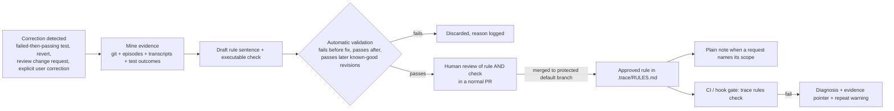

# TRACE guardrails: corrections become reviewed, executable rules

**Date:** 2026-11-16. **Status:** direction accepted. Rule generation is the next research gate. Nothing here is validated yet.

**Ratings:**
- Product ideation: 9.3/10 (external review), 8.5/10 (mine before review).
- Evidence maturity: 6.5/10. Detection is shown; rule generation is unproven.

## Positioning

> Every correction becomes a chance to prevent the next regression.

**Not** "agents never repeat a mistake". A check stops a *covered* violation from passing an *enforced* gate. It cannot stop the agent writing the mistake, cover every variant of it, or stop someone bypassing CI.

## The loop

- Nothing is promoted automatically. A historical claim, transcript line or agent finding can only become a *proposed* rule, and approval is a reviewed merge.
- Deeper memory (episodic, transcript, git, graph) stays fully available **on demand** through the existing MCP tools and CLI. It is not injected at routine session start.
- The graph's job here is selecting which checks run for a change (callers of changed code). It never goes into prompts.

## What already exists (`feat/executable-rules`, local)

- **Rules and approval:** `.trace/RULES.md` with approval by the default-branch ref, plus a warning when that ref is a local branch.
- **Notes-first session start:** the native hook, OpenCode and `trace context` inject the bare approved sentence when a request names the rule's function or file. Switch off with `TRACE_NOTES_FIRST=0`.
- **`trace rules check`:**
  - Runs approved checks and classifies each failure: flaky, environment, regression in progress, or stale-or-regression.
  - Gives a fixed next step for each class, the commits since approval, and a repeat warning based on the governed file's digest.
  - Lists approved rules with no checks.
- **Graph:** `module.func()` calls now resolve. Cross-file call edges in TRACE's own code rose from 79 to 534.
- **Correction signals already captured:** opt-in pytest outcomes, git events, transcripts.

**New work for the gate:**
- The drafting step.
- The validation pipeline.
- The evaluation harness.

## Next gate: correction-to-rule generation (preregistered)

This tests one link only: whether TRACE can turn real corrections into useful, valid, reviewable checks. It does **not** test whether recurrence drops. That needs a prospective study (below).

### Corpus

- **Size:** 40 corrections from 3–4 Python repositories never used in TRACE development. Excluded: TRACE, Click and Packaging.
- **Repository eligibility:** pure Python; the test suite runs under pytest in under 2 minutes; public PR and issue history.
- **A correction** is a merged commit that:
  - changes non-test code;
  - adds or changes at least one test that **fails on the parent and passes on the commit**;
  - links an issue or review comment describing the problem.
  - Refactors, features, dependency bumps and docs are excluded.
- **Selection:** the first 40 eligible commits in chronological order from a fixed start date, split as evenly as possible across repositories. The list (repository, SHA) is frozen and committed **before any generation runs**.

### Generator input

Only information that existed when the correction landed:
- the issue or review text;
- the pre-fix source of the touched files;
- the **non-test** part of the fix diff.

The generator never sees:
- **The fix commit's own tests.** They are the human baseline.
- **Later history or later outcomes.**
- **Any evaluation check.**

Including the non-test fix diff is deliberate. In the product, drafting happens after the correction lands, so the fix exists. Hiding it would test a different product.

**Generator settings:** Claude Opus 5.5, adaptive thinking, 3 independent drafts per correction (to measure variance). Each draft is one rule sentence (300 characters or fewer) and 1–6 checks (`py:` expressions or a pytest test).

### Automatic validation (before any human sees a draft)

1. **V1:** every check fails on the parent revision.
2. **V2:** every check passes on the fix revision.
3. **V3:** every check passes on later known-good revisions. Those are every release tag up to 12 months after the fix where the project's own suite passes. A failure here counts as a false alarm unless the project deliberately changed that behaviour, which is recorded case by case.
4. **V4:** checks run in under 10 seconds each.

### Human review (blind)

- **Pairing:** each surviving TRACE draft is paired with the fix commit's own tests, as the human-written baseline.
- **Blinding:** the reviewer sees both as "check A / check B", in shuffled order, with no indication of which is which.
- **Rating:**
  - (a) Does the rule state the real requirement? (0–2)
  - (b) Does the check express that requirement, rather than one historical input? (0–2)
  - (c) Would you merge it? (yes/no)
  - Time to decide, recorded.
- **Reviewer:** a person, not me. An LLM judge may add a secondary rating but never replaces the human.

### Recurrence-like detection, without waiting for real recurrences

- **Exact recurrence:** reverting the fix hunk. This is V1 again, and every survivor passes it by construction.
- **Near recurrences:** deterministic mutants of the fixed region, from standard mutation operators applied to the changed lines, generated once before generation runs.
- **Comparison:** kill rate of the TRACE checks vs. the human fix tests on the same mutants.
- **Real later regressions:** run surviving checks on every later commit, not just releases. A failure on a commit that is not known-good is a candidate caught regression, inspected by hand.

### Preregistered criteria

| Metric | Pass | Kill |
|---|---|---|
| Yield: corrections with at least one draft surviving V1–V4 | ≥ 60% | < 40% |
| False alarms: surviving checks failing a later known-good revision | ≤ 5% | > 10% |
| Relevance: survivors rated 2 on (a) and ≥ 1 on (b) | ≥ 70% | < 50% |
| Detection: mutant kill rate vs. human fix tests | ≥ 80% of human (non-inferior) | < 60% |
| Review effort: median time to approve a survivor | ≤ 3 min | > 10 min |
| CI overhead: all accepted checks per revision | ≤ 30 s | > 2 min |

- **If any kill threshold is hit:** stop rule generation. TRACE ships as notes-first plus the CI gate, with rules written by people.
- **If every pass threshold is met:** proceed to the prospective study.

Uncertainty is reported as Wilson 95% intervals on every rate. With 40 corrections, a 60% yield has an interval of roughly ±15 points, so the result is a gate, not a precise estimate.

### Cost and effort

- **API:**
  - Generation: 40 × 3 drafts, about 25k input and about 8k output tokens each (thinking included), about 3.0M input and 1.0M output. On Opus 5.5 that is about $12 + $20 = **$32**.
  - Optional LLM secondary rating: about $10.
  - With the Batch API, about half.
  - **Proposed cap: $100.** Nothing runs before you approve it.
- **Local compute:** V1–V3 and the mutants run tests at many revisions. That is hours of CPU, but free.
- **Engineering:** corpus mining and freezing, the validation harness, the mutant generator and the review packet come to roughly **4–6 days**. The drafting step itself is about a day. The one-week figure from before covered only drafting and was too optimistic.
- **Human time:** about 2–3 hours to review roughly 80–120 drafts blind.

## After the gate

- **Prospective study (only if the gate passes):** teams or projects using TRACE guardrails vs. ordinary maintained notes, over weeks. Measure recurrence of corrected mistakes, rules written, review time, CI false alarms and bypasses. Historical replay can show a check *would* have caught something; only this can show recurrence actually drops.
- **The capable-agent coding experiment** (notes vs. TRACE notes plus checks plus on-demand memory) stays postponed until the gate result, because its design depends on whether rules come from people or from TRACE.

## Explicitly not doing

- Automatic history injection at session start.
- LLM routing.
- Auto-approved rules.
- Graph output in prompts.
- Graphify integration.
- Trying to reach 24/24 on the old development benchmark.
